🇰🇷 [한국어](README.md) · 🇺🇸 **English** · 🇯🇵 [日本語](README.ja.md)

# 📊 Python Libraries for Data Collection & Analysis: The Basics (CLASS_PY_LIB_START)

  
  
  
  
  
  

> **From web crawling to data wrangling, visualization, and deploying dashboards!**  
> An introductory, hands-on course on practical Python libraries: collecting web data with BeautifulSoup/Selenium, preprocessing data with Pandas, visualizing with Matplotlib/Seaborn/Folium, integrating the ChatGPT API, and building web apps with Streamlit.  
> ⭐️ If this helps your learning, please give it a **Star** using the button at the top right!

> **Note:** All slides and notebooks (PDF/HTML) are written in Korean. The code runs the same in any language, and your browser's built-in translation (e.g. Chrome) works on the HTML pages.

  <a href="#️-learning-roadmap">🗺️ Learning Roadmap</a> •
  <a href="#️-1-web-data-collection-crawling--scraping">🕷️ Web Crawling</a> •
  <a href="#-2-data-wrangling--processing-pandas">🐼 Data Processing (Pandas)</a> •
  <a href="#-3-data-visualization--text-analysis">📈 Visualization & NLP</a> •
  <a href="#-4-modern-applications-chatgpt-api--streamlit-dashboards">🤖 ChatGPT & Streamlit</a> •
  <a href="#-5-hands-on-eda-project-bike-sharing-demand">🚲 Hands-on Project</a>

---

## 🗺️ Learning Roadmap

```mermaid
flowchart TD
    subgraph Step1 ["Step 01. Web Data Collection (Web Scraping)"]
        A["HTML Basics & Chrome DevTools"] --> B["BeautifulSoup4 (Static Web Crawling)"]
        B --> C["Selenium (Automated Collection from Dynamic Pages)"]
        C --> D["Practice: Collecting News, Movie Reviews, and Shopping Data"]
    end

    subgraph Step2 ["Step 02. Data Processing & Exploration (Pandas)"]
        E["Pandas DataFrame Basics & Manipulation"]
        F["Handling Missing Values & Transforming Data"]
        G["Practice: Titanic & California Housing Price Analysis"]
    end

    subgraph Step3 ["Step 03. Multidimensional Visualization & Text Analysis"]
        H["Matplotlib & Seaborn Charts"]
        I["Folium (Geospatial Map Visualization) & Plotly"]
        J["Korean Morphological Analysis with KoNLPy & NLTK"]
    end

    subgraph Step4 ["Step 04. Modern AI Integration & Dashboard Deployment"]
        K["Using the ChatGPT API & Sentiment Analysis"]
        L["Deploying Interactive Web Dashboards with Streamlit"]
    end

    D --> E
    G --> H
    H --> I
    H --> J
    J --> K
    I --> L

    style Step1 fill:#EFF6FF,stroke:#3B82F6,stroke-width:1.5px
    style Step2 fill:#F0FDFA,stroke:#0D9488,stroke-width:1.5px
    style Step3 fill:#FEF3C7,stroke:#D97706,stroke-width:1.5px
    style Step4 fill:#FAF5FF,stroke:#7E22CE,stroke-width:1.5px
```

---

## 🕷️ 1. Web Data Collection (Crawling & Scraping)

Techniques for understanding the structure of web pages (HTML/CSS) and automatically collecting the information you need with Python.

| Step | Topic | Description | Materials & Practice Links |
|:---:|:---|:---|:---:|
| **01** | **HTML Basics** | Understanding web page structure and practicing basic tags | [💻 Local Practice](./PYLIB_01_01_html) |
| **02** | **Chrome DevTools** | Inspecting elements (F12), extracting CSS Selectors and XPath | [📄 PDF Textbook](./PYLIB_01_02_크롬개발자도구/PYLIB_01_01_BS4_크롬개발자도구.pdf) |
| **02** | **BeautifulSoup Intro (Simple)** | Navigating tags and extracting text from static web pages | [📄 PDF](./PYLIB_01_BS4_01_Simple_v02.pdf) · [🌐 HTML](https://ldjwj.github.io/CLASS_PY_LIB_START/PYLIB_01_BS4_01_Simple_v02.html) |
| **02** | **BeautifulSoup Basics (Basic)** | Parsing attribute values, `find()`, `find_all()`, `select()` | [📄 PDF](./PYLIB_01_BS4_02_Basic_V11.pdf) · [🌐 HTML](https://ldjwj.github.io/CLASS_PY_LIB_START/PYLIB_01_BS4_02_Basic_V11.html) |
| **02** | **BeautifulSoup Advanced (2305)** | Modern web parsing patterns and exception handling | [📄 PDF](./PYLIB_02_01_BS4_Basic_2305.pdf) · [🌐 HTML](https://ldjwj.github.io/CLASS_PY_LIB_START/PYLIB_02_01_BS4_Basic_2305.html) |
| **03** | **Web Automation with Selenium** | Collecting pages rendered dynamically with JavaScript, automating clicks and scrolling | [📄 PDF](https://ldjwj.github.io/CLASS_PY_LIB_START/CL03_01_selenium_basic_V11.pdf) · [🌐 HTML](https://ldjwj.github.io/CLASS_PY_LIB_START/CL03_01_selenium_basic_V11.html) |

> **Hands-on collection assignments**:
> * 🎬 Collecting movie ratings and audience review text
> * 📰 Collecting news headlines and article bodies from major Korean web portals
> * 🛒 Collecting e-commerce product names, prices, and reviews
> * 📊 Crawling public data and COVID-19 statistics

---

## 🐼 2. Data Wrangling & Processing (Pandas)

Hands-on practice with the core library for shaping collected unstructured and structured data into tables that are easy to analyze.

| Step | Topic | Key Practice | Material Links |
|:---:|:---|:---|:---:|
| **06** | **Pandas Fundamentals** | Series and DataFrame structures, slicing and indexing | [📄 PDF Textbook](https://ldjwj.github.io/CLASS_PY_LIB_START/CL01_04_01_Pandas_기본_v10_2204.pdf) · [🌐 HTML](https://ldjwj.github.io/CLASS_PY_LIB_START/CL01_04_02_pandas_Basic_2204.html) |
| **06** | **Applied Pandas (California)** | Computing statistics, grouping (`groupby`), aggregation | [🌐 HTML](https://ldjwj.github.io/CLASS_PY_LIB_START/CL01_04_03_pandas_02_california_0502.html) ·  |
| **06** | **Titanic Data Preprocessing** | Imputing missing values, type conversion, creating derived variables | [🌐 HTML](https://ldjwj.github.io/CLASS_PY_LIB_START/CL01_04_03_titanic_dataset_220502.html) |

---

## 📈 3. Data Visualization & Text Analysis

Techniques for spotting patterns in data visually, and for cleaning and visualizing natural-language text.

| Area | Topic | Key Content | Link |
|:---|:---|:---|:---:|
| **Statistical Visualization** | **Seaborn Basics & Practice** | Scatter plots, histograms, box plots, and heatmaps | [🌐 HTML](https://ldjwj.github.io/CLASS_PY_LIB_START/PYLIB_05_01_Seaborn_Basic_V11.html) ·  |
| **Geographic Data** | **Spatial Visualization with Folium** | Placing map markers by latitude/longitude, clustering | [🌐 HTML](https://ldjwj.github.io/CLASS_PY_LIB_START/PYLIB_03_03_01_folium_local_2204.html) |
| **Interactive** | **Dynamic Charts with Plotly** | Web chart visualizations with zoom/pan interaction | [🌐 HTML](#) |
| **Natural Language Processing** | **KoNLPy & NLTK Basics** | Morphological analyzers (Okt, Kkma), tokenization, stopword removal | [🌐 HTML](https://ldjwj.github.io/CLASS_PY_LIB_START/PYLIB_03_01_konlpy_nltk_v01_2411.html) |
| **Text Visualization** | **Alice in Wonderland Word Cloud** | Word frequency analysis and shape-masked word clouds | [🌐 HTML](https://ldjwj.github.io/CLASS_PY_LIB_START/PYLIB_03_02_alice_extreme_V11_2411.html) ·  |

---

## 🤖 4. Modern Applications: ChatGPT API & Streamlit Dashboards

A modern, applied section that combines generative AI with a contemporary Python web dashboard framework.

* **🤖 ChatGPT API Integration & Sentiment Analysis**:
  * Calling the OpenAI API and prompt engineering basics: [🌐 HTML 01](https://ldjwj.github.io/CLASS_PY_LIB_START/CL01_01_konlpy_2204_v11.html)
  * Automatically classifying collected review text as positive or negative: [🌐 HTML 02](https://ldjwj.github.io/CLASS_PY_LIB_START/CL01_01_konlpy_2204_v11.html)
* **📊 Interactive Data Apps with Streamlit**:
  * Getting started with Streamlit & building basic widgets: [📄 PDF Textbook](https://ldjwj.github.io/CLASS_PY_LIB_START/PYLIB_06_01_streamlit01_시작하기.pdf)
  * Deploying a web dashboard that combines Pandas + Seaborn: [📄 PDF](https://ldjwj.github.io/CLASS_PY_LIB_START/PYLIB_06_01_streamlit02_lib01.pdf) · [🌐 HTML](https://ldjwj.github.io/CLASS_PY_LIB_START/PYLIB_06_01_streamlit02_lib01.html)

---

## 🚲 5. Hands-on EDA Project: Bike Sharing Demand

A comprehensive hands-on project that uses Kaggle's public bike-rental demand forecasting dataset and takes you all the way from preprocessing to exploratory data analysis (EDA).

* **Part 1: Loading the Data and Initial Exploration**:  
  [📄 PDF](https://ldjwj.github.io/CLASS_PY_LIB_START/Data_01_01_Bike_EDA_2204.pdf) · [🌐 HTML](https://ldjwj.github.io/CLASS_PY_LIB_START/Data_01_01_Bike_EDA_2204.html)
* **Part 2: Visualizing Time-Series and Weather Features (Detailed EDA)**:  
  [📄 PDF (A)](https://ldjwj.github.io/CLASS_PY_LIB_START/Data_01_02_Bike_EDA_2204.pdf) · [📄 PDF (B)](https://ldjwj.github.io/CLASS_PY_LIB_START/Data_01_03_Bike_EDA_2204.pdf)  
  [🌐 HTML (A)](https://ldjwj.github.io/CLASS_PY_LIB_START/Data_01_02_Bike_EDA_2204.html) · [🌐 HTML (B)](https://ldjwj.github.io/CLASS_PY_LIB_START/Data_01_03_Bike_EDA_2204.html)

---

## 🔗 License & Contact

* **Contact**: For copyright inquiries and other partnerships: [frontier1020@naver.com](mailto:frontier1020@naver.com)
* **License**: All materials in this repository are licensed under [CC BY-NC 4.0](LICENSE). You are free to use them for non-commercial purposes as long as you give attribution.
