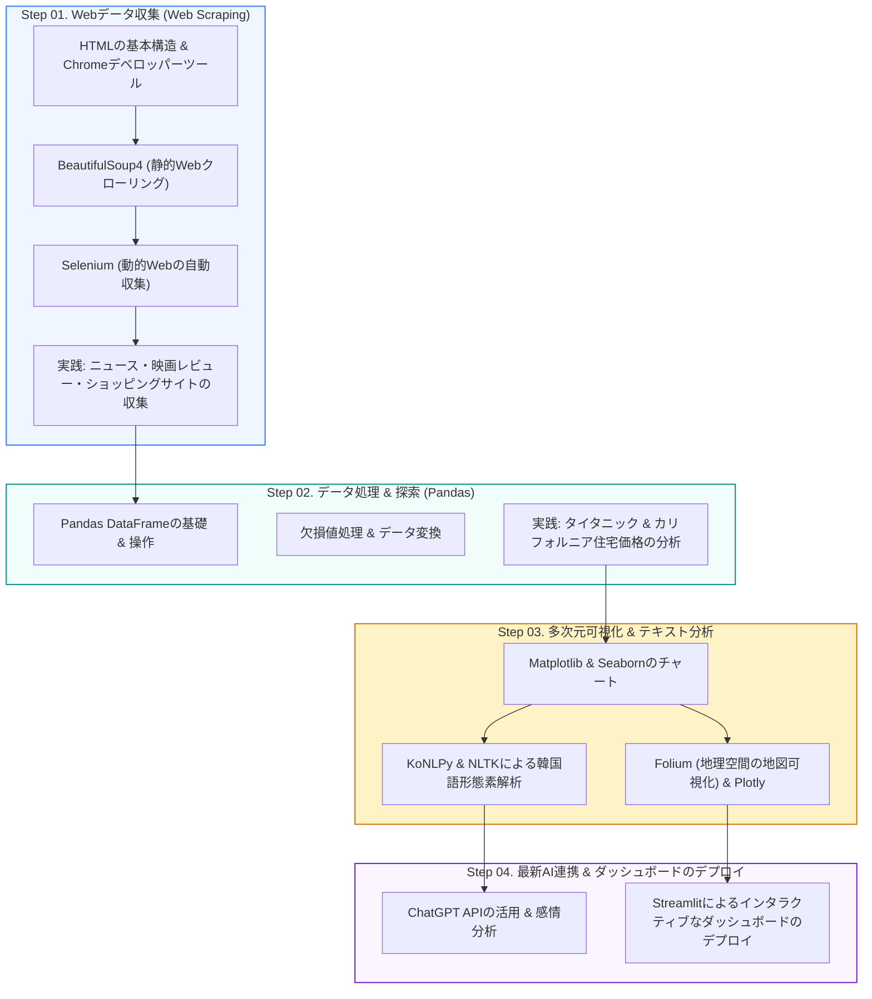

🇰🇷 [한국어](README.md) · 🇺🇸 [English](README.en.md) · 🇯🇵 **日本語**

# 📊 Pythonデータ収集＆分析ライブラリ入門 (CLASS_PY_LIB_START)

  
  
  
  
  
  

> **Webクローリングからデータ加工、可視化、そしてダッシュボードのデプロイまで！**  
> BeautifulSoup/SeleniumによるWebデータ収集、Pandasによるデータ前処理、Matplotlib/Seaborn/Foliumによる可視化、ChatGPT APIとの連携、StreamlitによるWebアプリ制作を扱う、Python実務ライブラリの入門教材です。  
> ⭐️ 学習のお役に立ちましたら、右上の **Star** ボタンを押していただけるとうれしいです！

> **ご注意：** 教材（PDF/HTML）はすべて **韓国語** で書かれています。コードはそのまま実行でき、HTMLページはブラウザ（Chromeなど）の自動翻訳で読むことができます。

  <a href="#️-学習ロードマップ">🗺️ 学習ロードマップ</a> •
  <a href="#️-1-webデータ収集クローリングスクレイピング">🕷️ Webクローリング</a> •
  <a href="#-2-データ加工処理pandas">🐼 データ処理（Pandas）</a> •
  <a href="#-3-データ可視化テキスト分析">📈 可視化＆NLP</a> •
  <a href="#-4-最新の応用chatgpt-apistreamlitダッシュボード">🤖 ChatGPT＆Streamlit</a> •
  <a href="#-5-実践edaプロジェクトbike-sharing-demand">🚲 実践プロジェクト</a>

---

## 🗺️ 学習ロードマップ

---

## 🕷️ 1. Webデータ収集（クローリング＆スクレイピング）

Webページの構造（HTML/CSS）を理解し、Pythonで必要な情報を自動的に収集する手法です。

| ステップ | 学習内容 | 詳細説明 | 教材・実習リンク |
|:---:|:---|:---|:---:|
| **01** | **HTMLの基本理解** | Webページの構造把握と基本タグの実習 | [💻 ローカル実習](./PYLIB_01_01_html) |
| **02** | **Chromeデベロッパーツール** | 要素の検証（F12）、CSSセレクタ・XPathの抽出方法 | [📄 PDF教材](./PYLIB_01_02_크롬개발자도구/PYLIB_01_01_BS4_크롬개발자도구.pdf) |
| **02** | **BeautifulSoup入門（Simple）** | 静的Webページのタグ探索とテキスト抽出 | [📄 PDF](./PYLIB_01_BS4_01_Simple_v02.pdf) · [🌐 HTML](https://ldjwj.github.io/CLASS_PY_LIB_START/PYLIB_01_BS4_01_Simple_v02.html) |
| **02** | **BeautifulSoup基本（Basic）** | 属性値のパース、`find()`、`find_all()`、`select()` | [📄 PDF](./PYLIB_01_BS4_02_Basic_V11.pdf) · [🌐 HTML](https://ldjwj.github.io/CLASS_PY_LIB_START/PYLIB_01_BS4_02_Basic_V11.html) |
| **02** | **BeautifulSoup応用（2305）** | 最新のWebパースパターンと例外処理 | [📄 PDF](./PYLIB_02_01_BS4_Basic_2305.pdf) · [🌐 HTML](https://ldjwj.github.io/CLASS_PY_LIB_START/PYLIB_02_01_BS4_Basic_2305.html) |
| **03** | **SeleniumによるWeb自動化** | JavaScriptで動的にレンダリングされるページの収集、クリック・スクロールの自動化 | [📄 PDF](https://ldjwj.github.io/CLASS_PY_LIB_START/CL03_01_selenium_basic_V11.pdf) · [🌐 HTML](https://ldjwj.github.io/CLASS_PY_LIB_START/CL03_01_selenium_basic_V11.html) |

> **実践的な収集課題**:
> * 🎬 映画の評価と観客レビューのテキスト収集
> * 📰 韓国の主要ポータルサイトのニュース記事タイトル・本文の収集
> * 🛒 ECサイトの商品名・価格・レビューの収集
> * 📊 公共データおよび新型コロナウイルスの統計情報のクローリング

---

## 🐼 2. データ加工＆処理（Pandas）

収集した非構造化／構造化データを、分析しやすいテーブル形式に加工するための中核ライブラリの実習です。

| ステップ | 学習テーマ | 主な実習内容 | 資料リンク |
|:---:|:---|:---|:---:|
| **06** | **Pandasの基本概念** | Series・DataFrameの構造とスライシング／インデックス参照 | [📄 PDF教材](https://ldjwj.github.io/CLASS_PY_LIB_START/CL01_04_01_Pandas_기본_v10_2204.pdf) · [🌐 HTML](https://ldjwj.github.io/CLASS_PY_LIB_START/CL01_04_02_pandas_Basic_2204.html) |
| **06** | **Pandas応用（カリフォルニア）** | 統計量の算出、グループ化（`groupby`）、集計 | [🌐 HTML](https://ldjwj.github.io/CLASS_PY_LIB_START/CL01_04_03_pandas_02_california_0502.html) ·  |
| **06** | **タイタニックデータの前処理** | 欠損値の補完、型変換、派生変数の作成 | [🌐 HTML](https://ldjwj.github.io/CLASS_PY_LIB_START/CL01_04_03_titanic_dataset_220502.html) |

---

## 📈 3. データ可視化＆テキスト分析

データのパターンを視覚的に把握し、自然言語テキストを整形・可視化する手法です。

| 分野 | テーマ | 主な内容 | リンク |
|:---|:---|:---|:---:|
| **統計の可視化** | **Seabornの基本＆実習** | 散布図、ヒストグラム、箱ひげ図、ヒートマップの可視化 | [🌐 HTML](https://ldjwj.github.io/CLASS_PY_LIB_START/PYLIB_05_01_Seaborn_Basic_V11.html) ·  |
| **地理情報** | **Foliumによる空間可視化** | 緯度／経度に基づく地図マーカーの表示、クラスタリング | [🌐 HTML](https://ldjwj.github.io/CLASS_PY_LIB_START/PYLIB_03_03_01_folium_local_2204.html) |
| **インタラクティブ** | **Plotlyによる動的チャート** | ズーム／パン操作に対応したWebチャートの可視化 | [🌐 HTML](#) |
| **自然言語処理** | **KoNLPy＆NLTKの基本** | 形態素解析器（Okt、Kkma）、トークン化、ストップワード除去 | [🌐 HTML](https://ldjwj.github.io/CLASS_PY_LIB_START/PYLIB_03_01_konlpy_nltk_v01_2411.html) |
| **テキストの可視化** | **『不思議の国のアリス』のワードクラウド** | 単語頻度分析と形状マスクを使ったワードクラウド | [🌐 HTML](https://ldjwj.github.io/CLASS_PY_LIB_START/PYLIB_03_02_alice_extreme_V11_2411.html) ·  |

---

## 🤖 4. 最新の応用：ChatGPT API＆Streamlitダッシュボード

生成AIと最新のPython Webダッシュボードフレームワークを組み合わせた、最新の応用パートです。

* **🤖 ChatGPT APIとの連携＆感情分析**:
  * OpenAI API呼び出しの基本とプロンプトエンジニアリング: [🌐 HTML 01](https://ldjwj.github.io/CLASS_PY_LIB_START/CL01_01_konlpy_2204_v11.html)
  * 収集したレビューテキストのポジティブ／ネガティブ感情の自動分類: [🌐 HTML 02](https://ldjwj.github.io/CLASS_PY_LIB_START/CL01_01_konlpy_2204_v11.html)
* **📊 Streamlitによるインタラクティブなデータアプリ**:
  * Streamlit入門＆基本ウィジェットの構成: [📄 PDF教材](https://ldjwj.github.io/CLASS_PY_LIB_START/PYLIB_06_01_streamlit01_시작하기.pdf)
  * Pandas＋Seabornを組み合わせたWebダッシュボードのデプロイ: [📄 PDF](https://ldjwj.github.io/CLASS_PY_LIB_START/PYLIB_06_01_streamlit02_lib01.pdf) · [🌐 HTML](https://ldjwj.github.io/CLASS_PY_LIB_START/PYLIB_06_01_streamlit02_lib01.html)

---

## 🚲 5. 実践EDAプロジェクト：Bike Sharing Demand

Kaggleの公共自転車レンタル需要予測データセットを使い、前処理から探索的データ分析（EDA）までをやり遂げる総合実践プロジェクトです。

* **Part 1：データの読み込みと基本的な探索**:  
  [📄 PDF](https://ldjwj.github.io/CLASS_PY_LIB_START/Data_01_01_Bike_EDA_2204.pdf) · [🌐 HTML](https://ldjwj.github.io/CLASS_PY_LIB_START/Data_01_01_Bike_EDA_2204.html)
* **Part 2：時系列と天候の特徴量の可視化（EDA詳細）**:  
  [📄 PDF (A)](https://ldjwj.github.io/CLASS_PY_LIB_START/Data_01_02_Bike_EDA_2204.pdf) · [📄 PDF (B)](https://ldjwj.github.io/CLASS_PY_LIB_START/Data_01_03_Bike_EDA_2204.pdf)  
  [🌐 HTML (A)](https://ldjwj.github.io/CLASS_PY_LIB_START/Data_01_02_Bike_EDA_2204.html) · [🌐 HTML (B)](https://ldjwj.github.io/CLASS_PY_LIB_START/Data_01_03_Bike_EDA_2204.html)

---

## 🔗 ライセンスとお問い合わせ

* **お問い合わせ**: 著作権に関するお問い合わせ・その他の提携について: [frontier1020@naver.com](mailto:frontier1020@naver.com)
* **ライセンス**: 本リポジトリのすべての資料は [CC BY-NC 4.0](LICENSE) ライセンスに従います。出典を明記すれば、非営利目的で自由にご利用いただけます。
