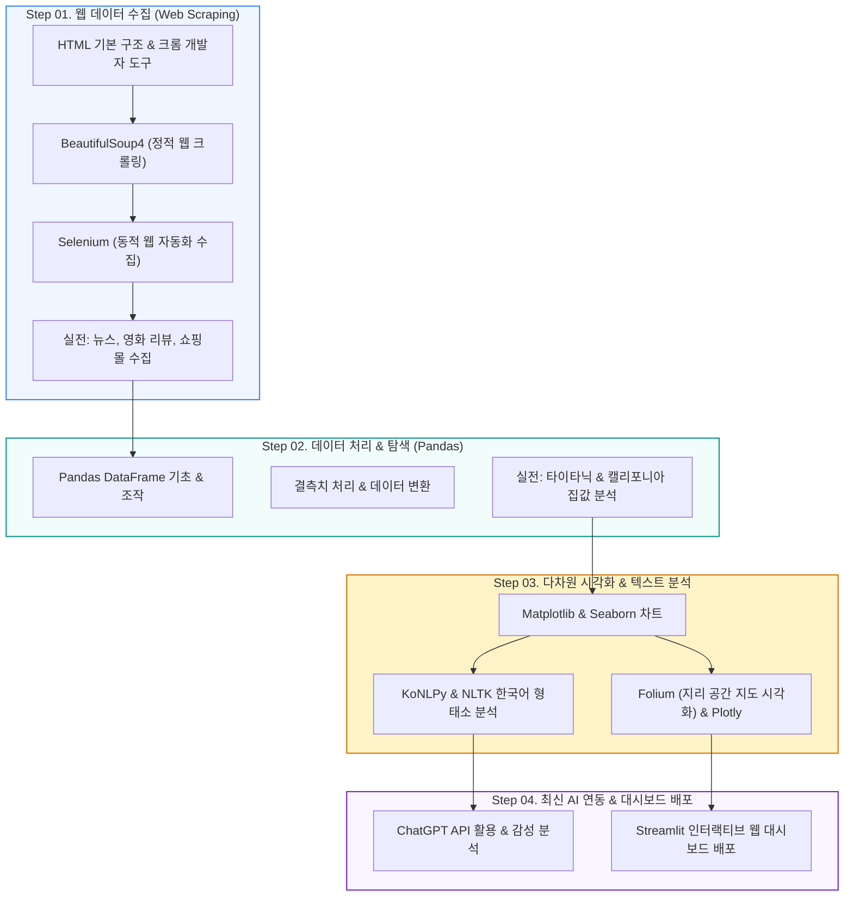

🇰🇷 **한국어** · 🇺🇸 [English](README.en.md) · 🇯🇵 [日本語](README.ja.md)

# 📊 파이썬 데이터 수집 & 분석 라이브러리 기초 (CLASS_PY_LIB_START)

  
  
  
  
  
  

> **웹 크롤링부터 데이터 가공, 시각화, 그리고 대시보드 배포까지!**  
> BeautifulSoup/Selenium을 활용한 웹 데이터 수집, Pandas 데이터 전처리, Matplotlib/Seaborn/Folium 시각화, ChatGPT API 연동 및 Streamlit 웹 앱 제작을 다루는 파이썬 실무 라이브러리 입문 교재입니다.  
> ⭐️ 학습에 도움이 되셨다면 우측 상단의 **Star** 버튼을 꾹 눌러주세요!

  <a href="#️-학습-로드맵">🗺️ 학습 로드맵</a> •
  <a href="#️-1-웹-데이터-수집-크롤링--스크래핑">🕷️ 웹 크롤링</a> •
  <a href="#-2-데이터-가공--처리-pandas">🐼 데이터 처리(Pandas)</a> •
  <a href="#-3-데이터-시각화--텍스트-분석">📈 시각화 & NLP</a> •
  <a href="#-4-최신-응용-chatgpt-api--streamlit-대시보드">🤖 ChatGPT & Streamlit</a> •
  <a href="#-5-실전-eda-프로젝트-bike-sharing-demand">🚲 실전 프로젝트</a>

---

## 🗺️ 학습 로드맵

---

## 🕷️ 1. 웹 데이터 수집 (크롤링 & 스크래핑)

웹 페이지의 구조(HTML/CSS)를 이해하고 파이썬으로 원하는 정보를 자동으로 수집하는 기법입니다.

| 단계 | 학습 내용 | 상세 설명 | 교재 및 실습 링크 |
|:---:|:---|:---|:---:|
| **01** | **HTML 기본 이해** | 웹 페이지 구조 파악 및 기본 태그 실습 | [💻 로컬 실습](./PYLIB_01_01_html) |
| **02** | **크롬 개발자 도구** | 요소 검사(F12), CSS Selector, XPath 추출법 | [📄 PDF 교재](./PYLIB_01_02_크롬개발자도구/PYLIB_01_01_BS4_크롬개발자도구.pdf) |
| **02** | **BeautifulSoup 기초 (Simple)** | 정적 웹 페이지 태그 탐색 및 텍스트 추출 | [📄 PDF](./PYLIB_01_BS4_01_Simple_v02.pdf) · [🌐 HTML](https://ldjwj.github.io/CLASS_PY_LIB_START/PYLIB_01_BS4_01_Simple_v02.html) |
| **02** | **BeautifulSoup 기본 (Basic)** | 속성값 파싱, `find()`, `find_all()`, `select()` | [📄 PDF](./PYLIB_01_BS4_02_Basic_V11.pdf) · [🌐 HTML](https://ldjwj.github.io/CLASS_PY_LIB_START/PYLIB_01_BS4_02_Basic_V11.html) |
| **02** | **BeautifulSoup 심화 (2305)** | 최신 웹 파싱 패턴 및 예외 처리 | [📄 PDF](./PYLIB_02_01_BS4_Basic_2305.pdf) · [🌐 HTML](https://ldjwj.github.io/CLASS_PY_LIB_START/PYLIB_02_01_BS4_Basic_2305.html) |
| **03** | **Selenium 웹 자동화** | 자바스크립트 동적 렌더링 페이지 수집, 클릭/스크롤 자동화 | [📄 PDF](https://ldjwj.github.io/CLASS_PY_LIB_START/CL03_01_selenium_basic_V11.pdf) · [🌐 HTML](https://ldjwj.github.io/CLASS_PY_LIB_START/CL03_01_selenium_basic_V11.html) |

> **실전 응용 수집 과제**:
> * 🎬 영화 평점 및 관람객 리뷰 텍스트 수집
> * 📰 주요 포털 뉴스 기사 제목 및 본문 수집
> * 🛒 e커머스 상품명, 가격, 리뷰 수집
> * 📊 공공 데이터 및 코로나 통계 현황 크롤링

---

## 🐼 2. 데이터 가공 & 처리 (Pandas)

수집된 비정형/정형 데이터를 분석하기 쉬운 테이블 형태로 가공하는 핵심 라이브러리 실습입니다.

| 단계 | 학습 주제 | 주요 실습 내용 | 자료 링크 |
|:---:|:---|:---|:---:|
| **06** | **Pandas 기본 개념** | Series, DataFrame 구조 및 슬라이싱/인덱싱 | [📄 PDF 교재](https://ldjwj.github.io/CLASS_PY_LIB_START/CL01_04_01_Pandas_기본_v10_2204.pdf) · [🌐 HTML](https://ldjwj.github.io/CLASS_PY_LIB_START/CL01_04_02_pandas_Basic_2204.html) |
| **06** | **Pandas 응용 (캘리포니아)** | 통계량 산출, 그룹화(`groupby`), 집계 | [🌐 HTML](https://ldjwj.github.io/CLASS_PY_LIB_START/CL01_04_03_pandas_02_california_0502.html) ·  |
| **06** | **타이타닉 데이터 전처리** | 결측치 대체, 타입 변환, 파생 변수 생성 | [🌐 HTML](https://ldjwj.github.io/CLASS_PY_LIB_START/CL01_04_03_titanic_dataset_220502.html) |

---

## 📈 3. 데이터 시각화 & 텍스트 분석

데이터의 패턴을 시각적으로 파악하고 자연어 텍스트를 정제·시각화하는 기법입니다.

| 분야 | 주제 | 핵심 내용 | 링크 |
|:---|:---|:---|:---:|
| **통계 시각화** | **Seaborn 기본 & 실습** | 산점도, 히스토그램, 박스플롯, 히트맵 시각화 | [🌐 HTML](https://ldjwj.github.io/CLASS_PY_LIB_START/PYLIB_05_01_Seaborn_Basic_V11.html) ·  |
| **지리 정보** | **Folium 공간 시각화** | 위도/경도 기반 지도 마커 표시, 클러스터링 | [🌐 HTML](https://ldjwj.github.io/CLASS_PY_LIB_START/PYLIB_03_03_01_folium_local_2204.html) |
| **인터랙티브** | **Plotly 동적 차트** | 줌/팬 인터랙션 지원 웹 차트 시각화 | [🌐 HTML](#) |
| **자연어 처리** | **KoNLPy & NLTK 기본** | 형태소 분석기(Okt, Kkma), 토큰화, 불용어 제거 | [🌐 HTML](https://ldjwj.github.io/CLASS_PY_LIB_START/PYLIB_03_01_konlpy_nltk_v01_2411.html) |
| **텍스트 시각화** | **앨리스 워드클라우드** | 단어 빈도 분석 및 형태 마스크 워드클라우드 | [🌐 HTML](https://ldjwj.github.io/CLASS_PY_LIB_START/PYLIB_03_02_alice_extreme_V11_2411.html) ·  |

---

## 🤖 4. 최신 응용: ChatGPT API & Streamlit 대시보드

생성형 AI와 현대적인 파이썬 웹 대시보드 프레임워크를 결합한 최신 응용 파트입니다.

* **🤖 ChatGPT API 연동 & 감성 분석**:
  * OpenAI API 호출 기본 및 프롬프트 엔지니어링: [🌐 HTML 01](https://ldjwj.github.io/CLASS_PY_LIB_START/CL01_01_konlpy_2204_v11.html)
  * 수집된 리뷰 텍스트 자동 긍/부정 감성 분류: [🌐 HTML 02](https://ldjwj.github.io/CLASS_PY_LIB_START/CL01_01_konlpy_2204_v11.html)
* **📊 Streamlit 인터랙티브 데이터 앱**:
  * Streamlit 시작하기 & 기본 위젯 구성: [📄 PDF 교재](https://ldjwj.github.io/CLASS_PY_LIB_START/PYLIB_06_01_streamlit01_시작하기.pdf)
  * Pandas + Seaborn 결합 웹 대시보드 배포: [📄 PDF](https://ldjwj.github.io/CLASS_PY_LIB_START/PYLIB_06_01_streamlit02_lib01.pdf) · [🌐 HTML](https://ldjwj.github.io/CLASS_PY_LIB_START/PYLIB_06_01_streamlit02_lib01.html)

---

## 🚲 5. 실전 EDA 프로젝트: Bike Sharing Demand

캐글(Kaggle)의 공공 자전거 대여 수요 예측 데이터셋을 활용하여 전처리부터 탐색적 분석(EDA)까지 완주하는 종합 실전 프로젝트입니다.

* **Part 1: 데이터 불러오기 및 기본 탐색**:  
  [📄 PDF](https://ldjwj.github.io/CLASS_PY_LIB_START/Data_01_01_Bike_EDA_2204.pdf) · [🌐 HTML](https://ldjwj.github.io/CLASS_PY_LIB_START/Data_01_01_Bike_EDA_2204.html)
* **Part 2: 시계열 및 날씨 특성 시각화 (EDA 상세)**:  
  [📄 PDF (A)](https://ldjwj.github.io/CLASS_PY_LIB_START/Data_01_02_Bike_EDA_2204.pdf) · [📄 PDF (B)](https://ldjwj.github.io/CLASS_PY_LIB_START/Data_01_03_Bike_EDA_2204.pdf)  
  [🌐 HTML (A)](https://ldjwj.github.io/CLASS_PY_LIB_START/Data_01_02_Bike_EDA_2204.html) · [🌐 HTML (B)](https://ldjwj.github.io/CLASS_PY_LIB_START/Data_01_03_Bike_EDA_2204.html)

---

## 🔗 라이선스 및 문의

* **문의 사항**: 저작권 문의 및 기타 제휴: [frontier1020@naver.com](mailto:frontier1020@naver.com)
* **라이선스**: 본 저장소의 모든 자료는 [CC BY-NC 4.0](LICENSE) 라이선스를 따릅니다. 출처를 표시하면 비영리 목적으로 자유롭게 활용하실 수 있습니다.
